# Cài đặt AuraTranslate

## Bản cài này không được ký số

Bản `.dmg` (macOS) và `.msi` (Windows) **không được ký số và không được notarize**. AuraTranslate là dự án phi lợi nhuận, mã nguồn mở GPL-3.0-or-later; chứng chỉ nhà phát triển của Apple (để ký và notarize) và chứng chỉ ký mã của Windows đều tốn phí hằng năm, và dự án không có kinh phí cho chúng.

Vì vậy hệ điều hành sẽ cảnh báo ở lần mở đầu: Gatekeeper trên macOS, SmartScreen trên Windows. Cảnh báo đến từ việc thiếu chữ ký, không phải từ nội dung tệp. Để biết tệp bạn tải về đúng là tệp do GitHub Actions dựng, hãy đối chiếu SHA-256 (bước đầu của mỗi phần dưới đây) trước khi mở.

Hướng dẫn không bao giờ yêu cầu bạn tắt Gatekeeper hay SmartScreen cho toàn máy; mỗi bước chỉ cho phép đúng một ứng dụng này.

Tải bản cài từ trang Releases của dự án: <https://github.com/vannamhh/AuraTranslate/releases>. Tên tệp trong ảnh và lệnh dưới đây là của bản `0.1.0`; bản sau đổi số phiên bản.

## macOS

Tên tệp: `AuraTranslate_0.1.0_universal.dmg` (chạy trên cả Apple Silicon lẫn Intel). Ảnh chụp trên macOS 15.8.2, máy Intel; trên máy Apple Silicon chưa được kiểm tra. Nếu macOS báo ứng dụng "is damaged and can't be opened" (đã hỏng và không thể mở), đừng tìm cách lách: hãy báo trên trang Issues của dự án. Nếu macOS của bạn dùng tiếng Việt, tên nút sẽ là bản tiếng Việt ghi trong ngoặc.

### Bước 1. Đối chiếu SHA-256

Tải cả `AuraTranslate_0.1.0_universal.dmg` và `SHA256SUMS.txt` về cùng một thư mục. Mở Terminal, vào thư mục đó và chạy:

```sh
shasum -a 256 AuraTranslate_0.1.0_universal.dmg
shasum -a 256 -c --ignore-missing SHA256SUMS.txt
```

Dòng thứ hai phải in `AuraTranslate_0.1.0_universal.dmg: OK`. Hoa thường trong hash không quan trọng.

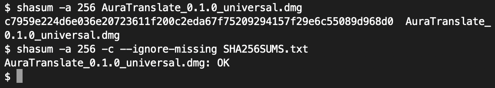

Nếu kết quả lệch (không phải `OK`): đừng mở tệp, hãy xoá và tải lại. Tải lại vẫn lệch thì báo trên trang Issues của dự án, kèm tên tệp và hash bạn thấy.

### Bước 2. Mở tệp .dmg và kéo vào Applications

Nháy đúp `AuraTranslate_0.1.0_universal.dmg`, rồi kéo biểu tượng AuraTranslate vào thư mục Applications.

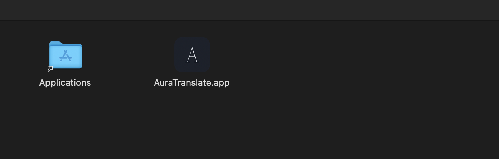

### Bước 3. Mở ứng dụng và gặp hộp thoại chặn

Mở AuraTranslate từ Applications. macOS hiện hộp thoại "“AuraTranslate.app” Not Opened". Đây là Gatekeeper. Nhấn **Done**, không chọn Move to Bin.

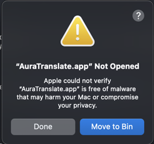

### Bước 4. Cho phép ứng dụng

**macOS 15 trở lên (đã chụp ảnh):** mở **System Settings** (Cài đặt hệ thống) → **Privacy & Security** (Quyền riêng tư & Bảo mật), cuộn xuống phần Security, nhấn **Open Anyway** (Vẫn mở) cạnh dòng nói AuraTranslate bị chặn.

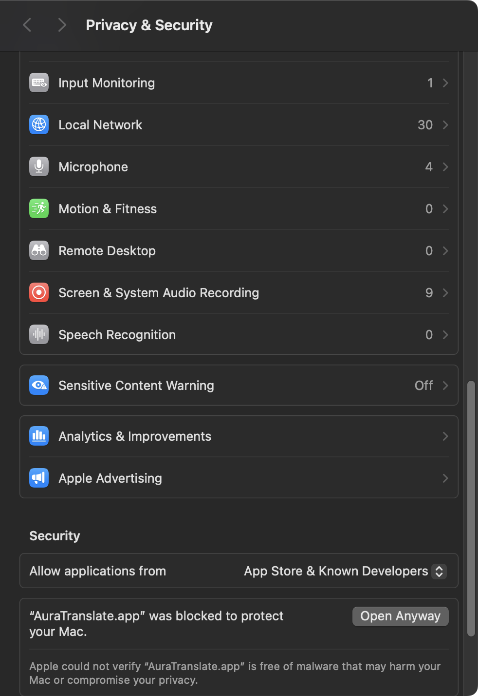

Hộp thoại xác nhận "Open “AuraTranslate.app”?" hiện ra; nhấn **Open Anyway** và nhập mật khẩu máy khi được hỏi.

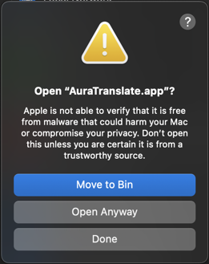

**macOS 14 trở xuống (chưa có ảnh):** nhấn chuột phải (hoặc Control + nhấn) vào AuraTranslate trong Applications, chọn **Mở** (Open), rồi nhấn **Mở** trong hộp thoại. Nhánh này chưa được chụp ảnh vì chưa có máy macOS cũ để đo.

### Bước 5. Cửa sổ AuraTranslate đầu tiên

Sau bước trên, AuraTranslate mở. Những lần sau mở bình thường, không còn cảnh báo.

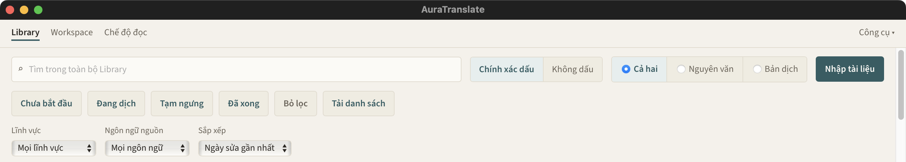

## Windows

Tên tệp: `AuraTranslate_0.1.0_x64_en-US.msi` (có nhúng sẵn WebView2, cài được khi không có mạng).

### Bước 1. Tải về và giữ tệp

Tải `AuraTranslate_0.1.0_x64_en-US.msi` và `SHA256SUMS.txt` bằng Edge hoặc Chrome. Trình duyệt có thể báo tệp "không thường được tải xuống"; mở menu của mục tải và chọn **Keep** (Giữ), nếu được hỏi thì chọn **Keep anyway**. Bước này chưa có ảnh; ảnh sẽ được thêm từ bản phát hành đầu tiên.

### Bước 2. Đối chiếu SHA-256

Mở PowerShell trong thư mục chứa tệp và chạy:

```powershell
Get-FileHash .\AuraTranslate_0.1.0_x64_en-US.msi -Algorithm SHA256
```

So hash in ra với dòng của `AuraTranslate_0.1.0_x64_en-US.msi` trong `SHA256SUMS.txt`. Hoa thường trong hash không quan trọng.

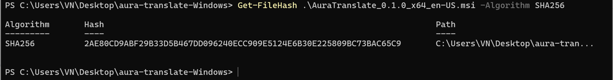

Nếu hai hash lệch: đừng mở tệp, hãy xoá và tải lại. Tải lại vẫn lệch thì báo trên trang Issues của dự án, kèm tên tệp và hash bạn thấy.

### Bước 3. Vượt cảnh báo SmartScreen

Nháy đúp tệp `.msi`. Windows hiện "Windows protected your PC" (Windows đã bảo vệ PC của bạn). Nhấn **More info**.

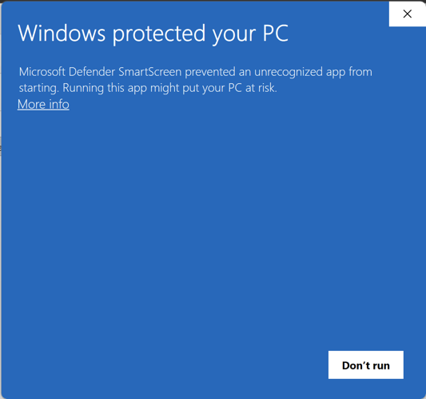

Nút **Run anyway** xuất hiện; nhấn nó.

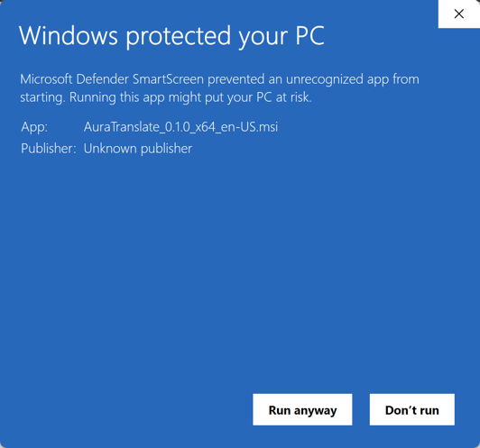

### Bước 4. Trình cài đặt

Trình cài đặt mở ở màn hình chào. Nhấn **Next**.

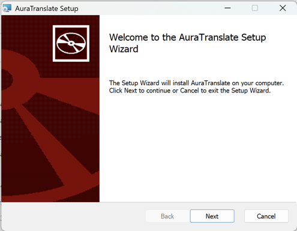

Chọn thư mục cài (mặc định dùng được) rồi nhấn **Next**.

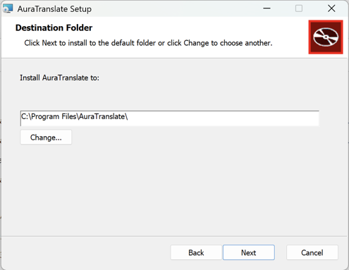

Nhấn **Install**.

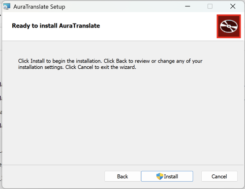

Windows hỏi quyền quản trị (UAC) và ghi "Publisher: Unknown" vì bản cài không ký số: nhấn **Yes**.

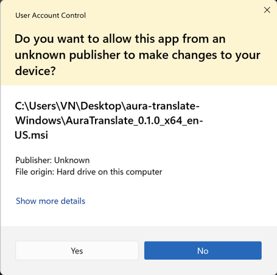

Chờ trình cài chạy xong.

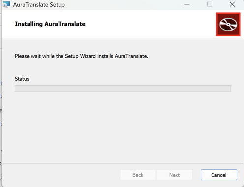

Để ô **Launch AuraTranslate** được đánh dấu và nhấn **Finish**.

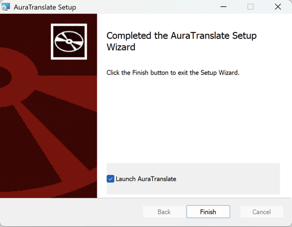

### Bước 5. Cửa sổ AuraTranslate đầu tiên

AuraTranslate mở ngay sau Finish. Những lần sau mở từ menu Start, không còn cảnh báo SmartScreen.

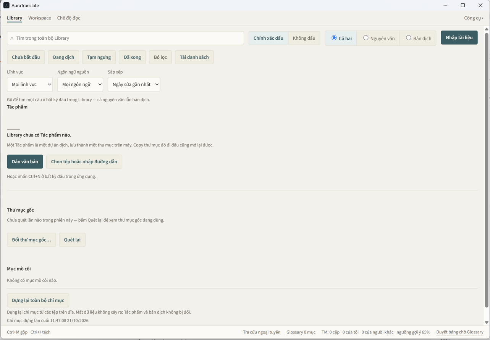
