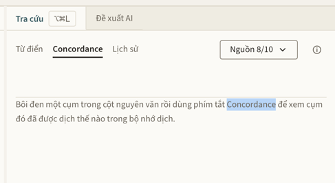

# Hướng Dẫn Tính Năng Concordance Trong AuraTranslate

## 1. Concordance Là Gì?

**Concordance** (hay *Concordance Search* – Tra cứu ngữ cảnh bộ nhớ dịch) là tính năng tra cứu chuyên dụng trong các phần mềm dịch thuật (CAT tools) và trong **AuraTranslate**.

Khác với tra từ điển thông thường hoặc so khớp toàn bộ câu (*Exact/Fuzzy Match*), **Concordance** cho phép bạn tìm kiếm một **từ hoặc cụm từ con** bất kỳ trong toàn bộ kho **Bộ nhớ dịch (Translation Memory - TM)** để xem từ/cụm từ đó đã từng được dịch như thế nào trong các câu trước đây.

---

## 2. Các Chức Năng Chính

* **Tra cứu cách dịch thực tế:** Trả lời câu hỏi: *"Trước đây cụm từ này mình đã dịch sang tiếng Việt như thế nào trong ngữ cảnh tương tự?"*.
* **Đảm bảo tính nhất quán (Consistency):** Giúp duy trì phong cách hành văn và cách dùng từ đồng nhất trong suốt tác phẩm hoặc giữa nhiều tác phẩm cùng thể loại/tác giả.
* **Hỗ trợ khi từ điển không có kết quả:** Các cụm từ lóng, xưng hô, quán ngữ, tên chiêu thức hoặc cách kết hợp từ mới thường không có trong từ điển; Concordance sẽ tận dụng kho dữ liệu dịch thực chiến đã tích lũy của bạn.
* **Đối chiếu song ngữ theo ngữ cảnh:** Hiển thị trực quan cặp câu **Nguyên văn ↔ Bản dịch**, tô nền cụm từ trong câu nguyên văn (kể cả khi câu cũ viết dạng phồn thể/giản thể khác với cụm bạn tra) để bạn thấy từ đó được xử lý linh hoạt ra sao trong từng cấu trúc câu khác nhau. Câu dịch không được tô, vì bộ nhớ dịch không lưu chữ nào trong bản dịch ứng với cụm nào trong nguyên văn.

---

## 3. Cách Sử Dụng Trong AuraTranslate

### Thao tác nhanh qua phím tắt:
1. **Bôi đen cụm từ** cần tra ở cột nguyên văn. Bôi đen ở cột bản dịch chỉ tra được khi đoạn bôi đúng là bản dịch của một thuật ngữ Glossary đã chốt trong câu đó; khi ấy AuraTranslate tra cụm tiếng Trung tương ứng.
2. **Nhấn phím tắt Concordance** (hoặc **chuột phải → Tra Concordance**):
   * **macOS:** `F3` hoặc `⌥ ⌘ N` (*Option + Command + N*)
   * **Windows:** `F3` hoặc `Ctrl + Alt + N`
3. **Xem kết quả:** Bảng điều khiển *Tra cứu* sẽ tự động chuyển sang tab **Concordance**, hiển thị số lượng cặp câu tìm thấy và danh sách các câu đã dịch trước đó.

### Thao tác qua giao diện:
1. Mở bảng điều khiển **Tra cứu** (Phím tắt: `⌥ ⌘ L` trên Mac / `Ctrl + Alt + L` trên Windows).
2. Bấm vào tab **Concordance** (nằm cạnh tab *Từ điển* và *Lịch sử*).
3. Bôi đen từ/cụm từ trên bảng soạn thảo rồi **chuột phải → Tra Concordance**.

---

## 4. Cơ Chế Hoạt Động Cần Lưu Ý

* **Tự động tích lũy:** Bạn không cần phải nhập tay dữ liệu vào Bộ nhớ dịch (TM). Mỗi khi bạn hoàn thành và xác nhận một câu dịch (Segment), câu đó sẽ tự động được lưu vào TM.
* **Hỗ trợ đa ngôn ngữ và chữ Hán:** AuraTranslate tự động xử lý và hỗ trợ tìm kiếm cả tiếng Trung (tự gập phồn thể / giản thể để không bỏ sót bản dịch cũ) và tiếng Việt.
* **Phạm vi TM:** Tìm kiếm trên cả Bộ nhớ dịch riêng của Tác phẩm đang mở và Bộ nhớ dịch toàn cục của hệ thống.
